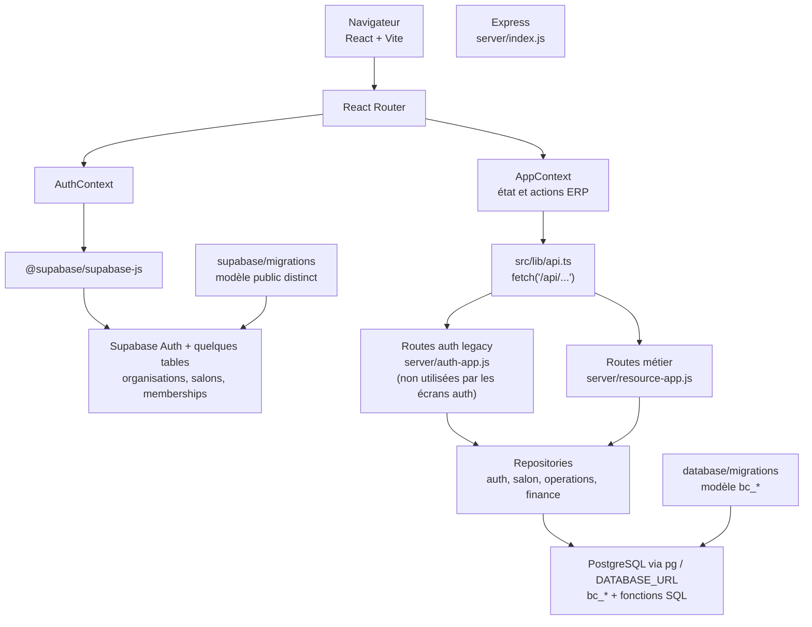
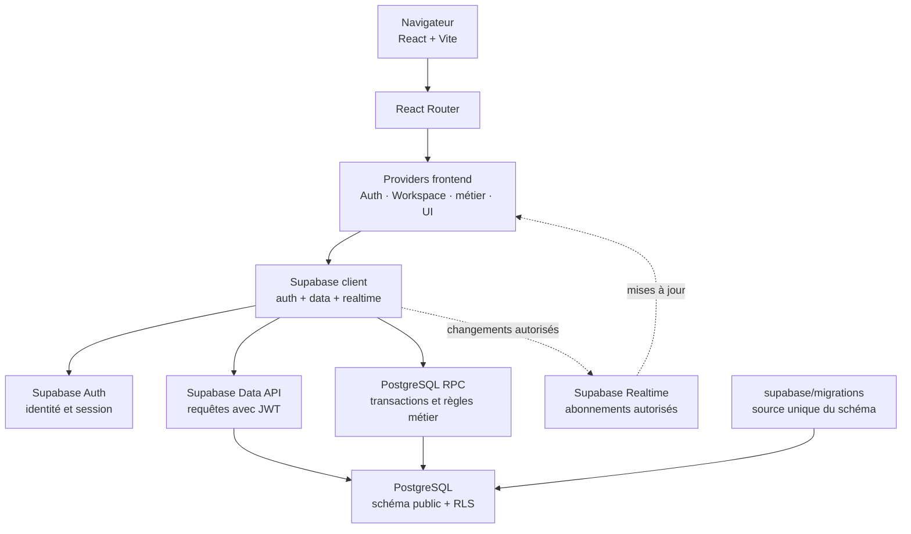

# Step 2 — Architecture et flux de données

## Décision d'architecture

Supabase est la source de vérité unique visée pour l'authentification et les
données applicatives. Le navigateur utilisera `@supabase/supabase-js` avec la
clé publique `anon`/publishable ; les droits des utilisateurs seront imposés
par PostgreSQL avec RLS et, pour les opérations atomiques ou métier, par des
fonctions RPC. Aucune clé `service_role` ne doit être intégrée au frontend.

Express et les connexions PostgreSQL directes ne font pas partie de la cible
finale. Ils ne pourront être retirés qu'après migration et validation de chaque
contrat API actuellement utilisé. Cette décision n'implique pas que cette
migration soit déjà achevée.

## Architecture actuelle constatée

Le frontend a donc actuellement deux chemins d'accès aux données : Supabase
direct dans le contexte d'authentification, et des routes Express pour les
ressources ERP. Les migrations `database/migrations` et
`supabase/migrations` décrivent par ailleurs des modèles différents (`bc_*`
contre des tables `public` sans préfixe). Il n'existe pas de synchronisation
automatique entre ces deux bases/modèles.

## Architecture cible

Responsabilités des couches :

| Couche | Responsabilité |
| --- | --- |
| Pages et composants | Présentation, formulaires, navigation et états de chargement/erreur |
| Contextes/hooks | État UI, session et sélection du workspace ; pas de SQL ni de logique d'autorisation |
| Repositories frontend | Requêtes Supabase typées et mapping entre lignes SQL et modèles UI |
| Supabase Auth | Inscription, connexion, confirmation e-mail, récupération et session |
| PostgREST + RLS | CRUD autorisé selon `auth.uid()` et les memberships actifs |
| Fonctions RPC | Mutations atomiques, transitions métier, disponibilité et autres invariants transactionnels |
| Migrations Supabase | Source versionnée unique du schéma, des fonctions, grants, RLS et publications Realtime |

## Contrats à migrer avant de retirer Express

Les appels existants dans `src/lib/api.ts`, `src/context/AppContext.tsx` et les
composants ERP couvrent notamment :

- auth : confirmation d'adresse, renvoi de confirmation, récupération et
  réinitialisation du mot de passe ;
- onboarding, création du salon, memberships et gestion des membres ;
- workspace, clients, prestations, succursales, horaires, personnel et absences ;
- rendez-vous, disponibilité, transitions d'état et historique ;
- dépenses, caisse, paiements, remboursements et rapports financiers ;
- stock, récompenses et avis.

Chaque contrat doit être remplacé par une opération Supabase équivalente, avec
contrôle RLS/RPC et tests. La présence d'une table homonyme ne suffit pas :
types, contraintes, relations, règles métier et permissions doivent aussi être
équivalents.

## Écarts et blocages vérifiés

1. `src/lib/api.ts` envoie encore les requêtes métier vers `/api/...`.
2. `server/resource-app.js` et les repositories utilisent les fonctions et
   tables `bc_*`; les migrations correspondantes sont sous `database/migrations`.
3. La migration présente sous `supabase/migrations` définit un modèle `public`
   différent et ne représente pas encore tous les domaines ERP.
4. Les écrans d'auth n'utilisent plus `authApi`, mais les routes
   `server/auth-app.js` et les tables d'auth Express restent présentes pour
   compatibilité/tests et doivent être retirées lorsque plus aucun contrat ne
   les utilise.
5. Supabase Realtime n'est pas, à lui seul, une stratégie de persistance ou de
   cohérence : les mutations doivent être confirmées par PostgreSQL et les
   abonnements filtrés par RLS.

## Avancement de la migration

- **Processus de migrations : mis en place.** `supabase/migrations/` est la
  source canonique Supabase ; la lignée `database/migrations/` reste isolée
  pour l'ancien modèle Express. La CI reconstruit le schéma sur un PostgreSQL
  Supabase local et lance son linter. Le déploiement distant est manuel,
  réservé à `main`, prévisualisé et protégé par l'environnement GitHub
  `supabase-production` (voir `docs/supabase-migrations.md`).
- **Socle tenant Supabase : implémenté et testé localement avec PGlite.** La
  migration `supabase/migrations/20261103160000_supabase_core.sql` crée les
  tables de base, les memberships liés à `auth.users`, les permissions RLS,
  les privilèges SQL minimaux et une création atomique du salon par RPC.
- Le RPC `create_salon` exige une identité authentifiée et un e-mail confirmé ;
  il crée organisation, salon, succursale, membership owner et état
  d'onboarding dans une seule transaction.
- Le frontend utilise désormais ce RPC pour créer le salon. Les tables Supabase
  ne sont pas encore la source de lecture/écriture des autres écrans ERP.
- Les écrans d'inscription, connexion, confirmation e-mail et récupération du
  mot de passe passent maintenant par Supabase Auth. L'état onboarding/memberships
  est lu via Supabase et la création du salon via RPC.
- Les memberships ont une affectation de succursale modélisée en base ; la
  création du salon attribue atomiquement la succursale principale au propriétaire.
- Le reset local ne charge pas de seed/demo data par défaut.
- **Phase 2 en cours :** la migration
  `supabase/migrations/20261103170000_branch_hours.sql` ajoute le modèle
  hebdomadaire des horaires de succursale, ses contraintes et politiques RLS.
  L'écran correspondant lit et enregistre maintenant les succursales et leurs
  horaires via Supabase avec RLS. La migration est vérifiée par tests PGlite
  tenant/rôle, mais n'a pas été poussée au projet distant.
- **Pas encore implémenté :** parité complète du domaine (rendez-vous,
  horaires des équipes et disponibilité,
  événements, caisse, paiements, remboursements, fidélité transactionnelle,
  invitations, rapports), Realtime et retrait des routes Express.
- **Projet Supabase distant vérifié :** le journal
  `supabase_migrations.schema_migrations` contient
  `20261103160000 / supabase_core`, identique à l'unique migration canonique
  locale. Les 15 tables `public` attendues sont présentes, RLS est activée sur
  les 15, les 37 policies sont chargées, et les RPC
  `create_salon`/`assign_member_to_branch` existent.
- La configuration locale `.env.local` contient l'URL de ce projet et une clé
  client Supabase ; les valeurs ne sont pas versionnées. Les tests PGlite ne
  remplacent pas les tests par la CLI et PostgreSQL Supabase local.

## Ordre de migration

1. Définir et tester le schéma canonique Supabase, en utilisant
   `auth.users.id` comme identité et `auth.uid()` pour l'autorisation.
2. Porter les règles multi-tenant et les opérations transactionnelles vers
   RLS, fonctions RPC et contraintes PostgreSQL ; adapter les migrations
   existantes au modèle Supabase plutôt que les copier telles quelles.
3. Remplacer les opérations d'auth Express par Supabase Auth et adapter
   confirmation, récupération de mot de passe et onboarding.
4. Migrer les repositories frontend par domaine, avec tests d'intégration
   contre Supabase local et tests de permissions entre tenants.
5. Découper `AppContext` en providers/hooks limités, après stabilisation des
   contrats de données.
6. Vérifier qu'aucun appel runtime ne dépend de `/api/...`, puis retirer
   Express, `pg`, `DATABASE_URL` et les anciens scripts/migrations d'exécution.
7. Ajouter les abonnements Realtime uniquement aux écrans qui en ont besoin ;
   tester reconnexion, filtrage RLS et rafraîchissement après mutation.

## Critères de fin de migration

- Une seule cible de données configurée : Supabase.
- Les migrations canoniques s'appliquent avec `supabase db reset`.
- Aucun secret privilégié n'est envoyé au navigateur.
- Les utilisateurs ne peuvent ni lire ni modifier les données d'un autre salon.
- Les mutations critiques sont atomiques et testées contre les cas concurrents.
- Tous les parcours ERP restent fonctionnels sans serveur Express.
- Aucune référence runtime à `/api/`, `DATABASE_URL`, Neon ou `pg` ne subsiste
  dans le frontend déployé.
